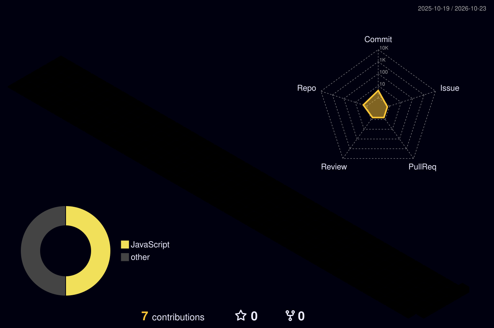
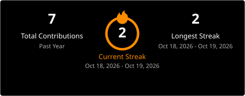

<div align="center">

<a href="https://github.com/shivbhardwaj009">

</a>

<br>

<p>
<a href="https://www.linkedin.com/in/shivbhardwaj009">

</a>
<a href="mailto:shivbhardwaj009@gmail.com">

</a>
</p>

<br>


</div>

<br>

---

## About Me

I'm **Shiv Bhardwaj**, a 3rd-year **B.Tech AI & Data Science** student at VIPS Delhi and a **Software Engineer Intern @ Kenet Technologies** (Sep 2026 – Present).

I build systems at the intersection of **AI/ML, IoT, autonomous robotics, and real-world products**.

Currently working on:

* 💼 Software Engineer Intern @ Kenet Technologies (Sep 2026 – Present)
* 🛸 Autonomous drone & GPS-denied navigation systems (SLAM)
* 🧠 Machine Learning & Model Development
* ⚡ Hardware & IoT (ESP32, Arduino, sensor integration)
* ⚙️ Production REST APIs & full-stack systems
* 🔬 Applied AI/ML for real-world automation

> **I don't just experiment with AI — I build systems that ship.**

---

## 🚀 Experience & Focus

```text
┌─────────────────────────────────────────────────────────────────┐
│                         CURRENT FOCUS                            │
├─────────────────────────────────────────────────────────────────┤
│                                                                 │
│  AI / ML            →  Model Dev · Data Analysis · Optimization │
│  Hardware & IoT     →  ESP32 · Arduino · Embedded · SLAM        │
│  Backend & Cloud    →  FastAPI · REST APIs · Firebase DB        │
│  Full-Stack         →  React.js · JavaScript · HTML/CSS         │
│  Domains            →  AI · ML · IoT · Fintech · Smart Auto     │
│  Tools              →  Git · VS Code · Arduino IDE              │
│                                                                 │
└─────────────────────────────────────────────────────────────────┘
```

### 💼 Software Engineer Intern — Kenet Technologies
**Sep 2026 – Present**

* Engineering intelligent software systems, cloud integrations, and smart automation workflows.

---

# 🧩 Featured Project

<table>
<tr>

<td width="100%" valign="top">

## 🛸 Autonomous Drone Defence System

### GPS-Denied Navigation, SLAM & Electronic-Warfare Resilience

* **GPS-Denied Navigation:** Designed and built an autonomous drone system capable of GPS-denied self-navigation using SLAM-based mapping and localization with onboard sensors.
* **Obstacle Avoidance & Path-Planning:** Implemented real-time obstacle avoidance and algorithm optimization for path-planning, ensuring reliable performance in constrained environments.
* **Electronic-Warfare Resilience:** Engineered navigation and control routines built for signal-denied and electronic-warfare-resilient operations.
* **Ground Control & Telemetry:** Developed ground control station interface and telemetry workflows for real-time monitoring, flight data, and mission control.

**Stack**

`Python` `C++` `SLAM` `ESP32` `Arduino` `Sensor Integration` `Autonomous Navigation`

</td>

</tr>
</table>

---

# 🛠️ Technical Skills

| Category | Skills |
| :--- | :--- |
| **Languages** | Python, C++, JavaScript, HTML/CSS |
| **Frameworks & Libraries** | React.js, Firebase, FastAPI |
| **AI/ML & Data** | Machine Learning, Model Development, Data Analysis, Data Visualization, Algorithm Optimization |
| **Hardware & IoT** | ESP32, Arduino, Embedded Systems, Sensor Integration, SLAM |
| **Cloud & Databases** | Firebase Real-Time Database, Cloud Integration, REST APIs |
| **Tools** | Git, VS Code, Arduino IDE |
| **Domains** | Artificial Intelligence, Machine Learning, IoT, Fintech, Smart Automation |

<br>

### Languages
<p>


</p>

### Frameworks & Libraries
<p>


</p>

### AI/ML & Data
<p>


</p>

### Hardware & IoT
<p>


</p>

### Cloud & Databases
<p>


</p>

### Tools
<p>


</p>

### Domains
<p>


</p>

---

# 📊 GitHub Activity

<div align="center">



<br><br>

### 🔥 Contribution Streak



<br><br>

<b>Building consistently. Learning continuously. Shipping deliberately.</b>

</div>

---

# 📈 Contribution Journey

```text
2024
 │
 ├── Autonomous Drone Defence System (GPS-denied Navigation, SLAM)
 ├── Engineering fundamentals (Python, C++)
 └── Sensor integration & embedded systems
        │
        ▼
2025
 │
 ├── AI/ML projects & model development
 ├── Edge AI & smart automation
 └── Real-world IoT & embedded systems
        │
        ▼
2026
 │
 ├── Software Engineer Intern @ Kenet Technologies (Sep 2026 – Present)
 ├── Production AI & full-stack systems
 └── Autonomous AI agents & cloud integration
        │
        ▼
     NEXT →
     Advanced Autonomous Systems
     Machine Learning & AI Engineering
     IoT & Robotics Integration
     Scalable Distributed Systems
```

---

<div align="center">

## Let's build something meaningful.

**AI/ML Internships · Software Engineering Internships · Research Collaborations**

<br>

<a href="https://www.linkedin.com/in/shivbhardwaj009">

</a>

<a href="mailto:shivbhardwaj009@gmail.com">

</a>

<br><br>

<sub>AI systems • software engineering • autonomous systems • IoT</sub>
<br><br>

<i>"Don't just learn — build something real."</i>

<br><br>


</div>
